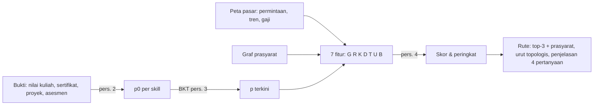

# Mesin Keputusan PathSync

Deterministik: input sama → output sama. LLM tidak ikut memutuskan. Kode: `backend/pathsync/{evidence,engine,calibration}.py`.

## Tahap

| # | Tahap | Rumus | Catatan |
|---|---|---|---|
| 1 | Bukti → p0 | p0 = Σ wₖ·rₖ·eₖ / Σ wₖ·rₖ | w = 0,20 / 0,25 / 0,30 / 0,50 (kuliah/sertifikat/proyek/asesmen); r = reliabilitas (proyek pending 0,5, ditolak 0) |
| 2 | Jawaban → p | BKT (slip 0,10, guess 0,25, learn 0,10) | akurasi dikoreksi tebakan e = (acc−0,25)/0,75 |
| 3 | Fitur | G kesenjangan, R permintaan, K tren, D kedekatan graf, T waktu belajar, U & B buka/bottleneck dependen langsung | Tabel 3 paper |
| 4 | Skor | f = Σ wᵢ·log xᵢ | formula 5 = kasus khusus; bobot model aktif bisa diperiksa |
| 5 | Rute | top-3 + prasyarat belum dikuasai | ditampilkan dengan alasan yang mengutip angka penguasaan |

## Pemicu adaptif
1. Bukti baru (proyek/tugas kuliah) → hitung ulang.
2. Asesmen ulang → BKT update.
3. Snapshot pasar berubah → dipropagasikan ke semua mahasiswa terdampak (`propagate_market_change`).

## Contoh (Tabel 4 paper)
SQL: p 0,95 → 0,17 setelah bukti asesmen salah; direproduksi persis di `tests/test_paper_fidelity.py`.

## Transparansi
`GET /api/students/{id}/trace/{skill}` mengembalikan kelima tahap dengan angka mahasiswa; dashboard menampilkannya di panel "How was this decided?". Tes memastikan Σ kontribusi = skor.
